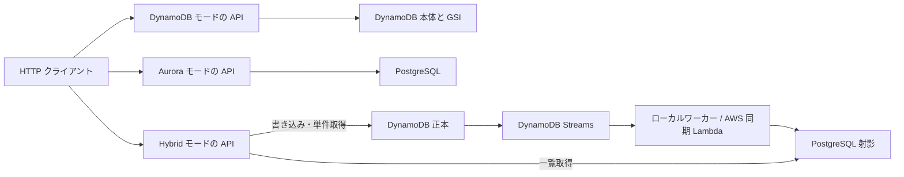

# DB を選んで商品 API を動かす

| DB モード | 登録・更新・削除・単件 GET | 一覧 GET | 一覧の反映 |
| --- | --- | --- | --- |
| `dynamodb` | DynamoDB のベーステーブル | 疎グローバルセカンダリインデックス（GSI） | 結果整合 |
| `aurora` | Aurora PostgreSQL | 同じ PostgreSQL の部分インデックス | コミット済みの行 |
| `hybrid` | 正本の DynamoDB | PostgreSQL の検索用射影 | Streams の処理を経て反映 |

ローカルでは DynamoDB Local と PostgreSQL を使います。通常の HTTP サーバーでは Netty が、SAM と AWS 向け構成では API Gateway イベントを処理する Micronaut のハンドラーが同じコントローラーを呼びます。DB モードは起動時に固定されます。モードごとに変わるデータの移行は別途行います。

DynamoDB は ID 検索と固定パターンの一覧を低い運用負荷で提供したいときに適しています。このサンプルの全商品 GSI は固定のパーティションキーを使うため、書き込みと読み込みが単一キーに集中する設計です。本番の高負荷ではアクセスパターンと分散方式を再検討します。PostgreSQL は複合条件、関連マスタ、トランザクションが重要な場合の候補です。Hybrid は正本の ID アクセスを維持しながら、一覧への反映遅延を許容できる場合に選択します。構成が増える分、同期の遅延、失敗、再構築を運用します。

## 同じ HTTP 契約で CRUD を呼ぶ

[OpenAPI](../openapi/products.yaml) と [HTTP 契約テスト](../tests/e2e.py) を参照してください。

- POST はサーバーで UUID v4 を採番します。書き込みの結果が不明なとき POST を再送すると新規登録になるため、リトライには注意が必要です。採番衝突は最大3回試行し、使い切ると `409` を返します。
- 変更可能なのは名称、分類、最小通貨単位の価格、状態です。PUT は全項目を送ります。PATCH で省略した項目は維持され、明示的な `null` は `400` です。削除も version を進めます。削除後の取得・更新・再削除は `404` です。
- 変更系では GET または直前の変更が返した強い ETag を `If-Match` に指定します。未指定は `428`、不正な形式は `400`、保存済みの version が変わっていれば `412` です。DynamoDB の条件付き書き込みと PostgreSQL の条件付き UPDATE が同時更新からデータを守ります。
- 入力チェック、リクエスト ID、エラー形式、version 規則は共通です。有効な `X-Request-Id` は受け継ぎ、省略時や無効な場合は生成します。応答に返す ID で構造化ログを照合できます。JSON 本文や認証情報はログ項目に含めません。
- DynamoDB の一覧は GSI のキー順で Query します。PostgreSQL は未削除商品の部分インデックスを利用し、`(created_at, id)` をキーセットの境界にします。比較条件にバインドした値を使用します。並び順は `createdAt` 降順、同時刻は ID 降順です。
- 次ページは返却された `nextToken` を同じモード・分類で指定します。現在の形式は版とモード・分類と DB 固有の位置を Base64URL で包みます。クライアントは内部形式に依存しません。データが固定されていれば全ページに欠落や重複はありません。ページを読んでいる間に分類変更、登録、削除、GSI や射影の反映が進む場合、1つの時点の一覧は保証されません。

## ローカルの設定を選ぶ

`APP_RUNTIME=local` では、DynamoDB の URL と固定ダミー SDK 認証情報、または PostgreSQL の明示的な JDBC URL とローカルユーザーが必要です。Compose が注入する値を [compose.yml](../docker/compose.yml) で確認できます。直接 JVM で起動する場合、DynamoDB のホストは `localhost`、`127.0.0.1`、`[::1]` または既知の Compose 名で、ポートを必ず指定します。DB 起動チェックとマイグレーションはアプリ起動とは別に行います。

AWS 用の設定は `APP_RUNTIME=aws` を明示します。Aurora を使う場合はアプリ用の Secrets Manager ARN と TLS 検証を設定します。通常 HTTP コンテナ、SAM、ローカル CLI には `local` を設定します。必要な値が欠けると起動時の設定エラーになります。

詳しい同期規則は [同期手順](sync.md)、AWS 向け構成と参照先は [Terraform 構成](iac.md) を参照してください。

## 固定した依存物を確認する

| 対象 | バージョンと参照先 |
| --- | --- |
| JVM と Gradle | Temurin 21.0.13+9、Gradle Wrapper 8.14.3。[Gradle Wrapper 設定](../app/gradle/wrapper/gradle-wrapper.properties) |
| API と Lambda | Micronaut Platform 4.10.25、AWS 統合 4.11.0、AWS SDK for Java v2 2.31.66。[Gradle ビルド](../app/build.gradle) |
| SQL | MyBatis 3.5.19、pgJDBC 42.7.10、Flyway 11.20.3。[Gradle ビルド](../app/build.gradle) |
| ローカル DB と Lambda エミュレーター | DynamoDB Local 3.3.2、PostgreSQL 16.14、SAM CLI 1.174.1 と Java 21 Lambda イメージ。[Compose](../docker/compose.yml) · [SAM の起動スクリプト](../scripts/local.sh) |
| IaC | Terraform 1.13.5、AWS Provider 6.20.0、Cloudflare Provider 5.19.1。[Provider ロック](../terraform/.terraform.lock.hcl) |

Java 21 の Gradle ビルドとハンドラーの互換性は、固定した Micronaut Platform、Micronaut AWS、Gradle の公式情報に従います。 [Micronaut Platform 4.10.25](https://github.com/micronaut-projects/micronaut-platform/blob/v4.10.25/gradle/libs.versions.toml) · [Micronaut AWS 4.11.0](https://micronaut-projects.github.io/micronaut-aws/4.11.0/guide/) · [Gradle の Java 互換性表](https://docs.gradle.org/8.14.3/userguide/compatibility.html#java) · [DynamoDB Local 公式イメージと起動方法](https://docs.aws.amazon.com/amazondynamodb/latest/developerguide/DynamoDBLocal.DownloadingAndRunning.html)
