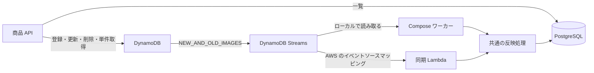

# DynamoDB の変更を PostgreSQL の商品検索へ反映する

Hybrid モードでは、登録・変更・削除・単件取得を DynamoDB で処理する。一覧は PostgreSQL の検索テーブルを参照する。反映までの間は、単件取得と一覧で異なる version が見えることや、片方だけに商品が見えることがある。



## 同じ変更を受け取っても、最新の商品を維持する

- INSERT と MODIFY は NewImage を反映する。論理削除は version を進めた MODIFY として届く。
- 物理削除の派生例では、商品を条件付きで消すと同時に DynamoDB に再構築用マーカーを保存する。反映処理は REMOVE の OldImage を元の version の削除マーカーとして扱う。専用マーカー自身のストリームレコードは、反映先に別の商品を作らないよう読み飛ばす。
- PostgreSQL の UPSERT は対象の version が大きい場合に更新する。同じ version で削除と有効な商品が競合したら削除を採用する。削除済み ID への有効データと、重複や古いレコードは UPSERT の条件で除外する。
- 検索テーブルは削除マーカーと version を保持する。これらを単独で消すと古いイベントで復活する可能性があるため、マーカーの自動期限は設定しない。
- 失敗後は同じレコードが再送される。Lambda は 1 レコードずつコミットし、失敗したレコードのシーケンス番号を `batchItemFailures` に返す。AWS のイベントソースマッピングは最初の失敗位置から後続レコードも再送し得る。 [Lambda の部分バッチ応答](https://docs.aws.amazon.com/lambda/latest/dg/services-ddb-batchfailurereporting.html)

## ローカルの失敗を確認して再投入する

```sh
make up DB=hybrid
./scripts/local.sh compose hybrid logs -f worker
./scripts/local.sh compose hybrid exec -T worker ls /sync/failed
make sync-replay
```

ワーカーは 250 ms 間隔で読み取りを試みる。親シャードを読み終えてから子シャードを処理し、PostgreSQL のコミットが成功してから対応するシーケンス番号を `/sync/checkpoints` に保存する。反映に失敗したレコードは `/sync/failed` に保存し、そのシャードを最後に成功した位置から読み直す。Docker ボリュームがチェックポイントと失敗レコードを保持する。

`make sync-replay` は保存済みレコードに共通の反映処理を実行し、成功したファイルを `/sync/replayed` に移動する。特定のファイルを処理するときは `FILE=<ファイル名>` を渡す。ワーカーを停止して再投入すると復旧を確認しやすい。ワーカーが再開すると同じレコードを読み、反映を確認してから自身のチェックポイントを進める。

Streams のレコードは AWS で最大 24 時間保持される。再開位置が期限切れの場合は、ワーカーのエラーを確認して検索テーブルを再構築する。このワーカーは DynamoDB Local 専用で、AWS ではイベントソースマッピングがチェックポイントと再試行を管理する。 [DynamoDB Streams のシャードと保持期間](https://docs.aws.amazon.com/amazondynamodb/latest/developerguide/Streams.html)

## 検索テーブルに初回反映し、再構築する

各コマンドは稼働中の Compose API とワーカーを一時停止する。SAM など別のプロセスから同じ DynamoDB へ書き込んでいる場合は、実行前に停止する。

```sh
make sync-backfill
make sync-rebuild
```

`sync-backfill` は DynamoDB の項目をページ単位で読み、通常の UPSERT で追加反映する。検索データ全体の置き換えには `sync-rebuild` を使う。再構築は正本の論理削除済みデータと物理削除マーカーを含むスナップショットを一時表へ読み込み、1 トランザクションで検索テーブルを置き換える。読み取りや置換に失敗した場合はロールバックする。

`sync-rebuild` はテーブルの置換完了後にチェックポイントを `/sync/checkpoints-<時刻>` に退避する。再開したワーカーは取得可能な最も古いレコードから読み直す。検索テーブルに反映済みの version は条件付き UPSERT が保護する。

## 実レコードで同期を検証する

```sh
make test-sync
```

独立した Compose プロジェクトで、通常の HTTP API から DynamoDB Local、実際の Streams レコード、PostgreSQL、一覧取得までをたどる。DynamoDB Local から取り出したレコードを SAM の同期 Lambda に渡し、重複・古い version・削除後の再送・一部の失敗を検証する。PostgreSQL の停止・復旧と失敗レコード再投入も行う。
